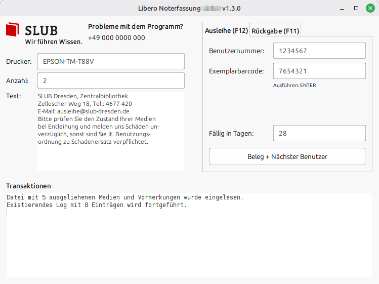

# Libero Noterfassung
Verbesserte Version der offiziellen "Libero Emergency Circulation"-Anwendung. Schreibt Ausleihen und Rückgaben in eine Textdatei, welche später in Libero importiert werden kann, sobald der Server wieder erreichbar ist.

- besseres UI
- plattformunabhängig
- (mehrfacher) Belegdruck
- Fortsetzen der Logdatei ohne Nachfrage
- Prüfung ausgeliehener Exemplare anhand des Barcodes (via mex.txt)
- Anzeige von Notizen des jeweiligen Exemplars (via mex.txt)
- Information bei der Rückgabe ob die Rückgabefrist überschritten wurde (via mex.txt)
- Prüfung auf Vormerkung und ggf. Druck des Vormerkbelegs (via mex.txt)

# Entwicklung
- `make`: erstellt build/SEC.jar
- `make compile`: kompiliert und kopiert das Logo
- `make run`: startet die Anwendung
- `make clean`: entfernt die erzeugten Build-Dateien

# Verwendung
- Anpassung der Texte in `config.properties` und ins Programmverzeichnis legen
- ggf. eigenes Logo in das Programmverzeichnis legen (`logo.png`, 150x43px)
- ggf. einen Libero-Export ausgeliehener Exemplare als `mex.txt` ins Programmverzeichnis legen
- Aufruf `java -jar SEC.jar` (Java/OpenJDK muss installiert sein)
  - optionaler Parameter: `--mex-file /path/to/mex.txt` (Standard: Arbeitsverzeichnis)
  - optionaler Parameter: `--log-file ~/libero.log` (Standard: Arbeitsverzeichnis)
- während der Laufzeit veränderter Druckername und Text wird abgespeichert unter:
  - Linux: `~/.java/.userPrefs`
  - Windows: Registry `HKEY_CURRENT_USER\Software\JavaSoft\Prefs\`
